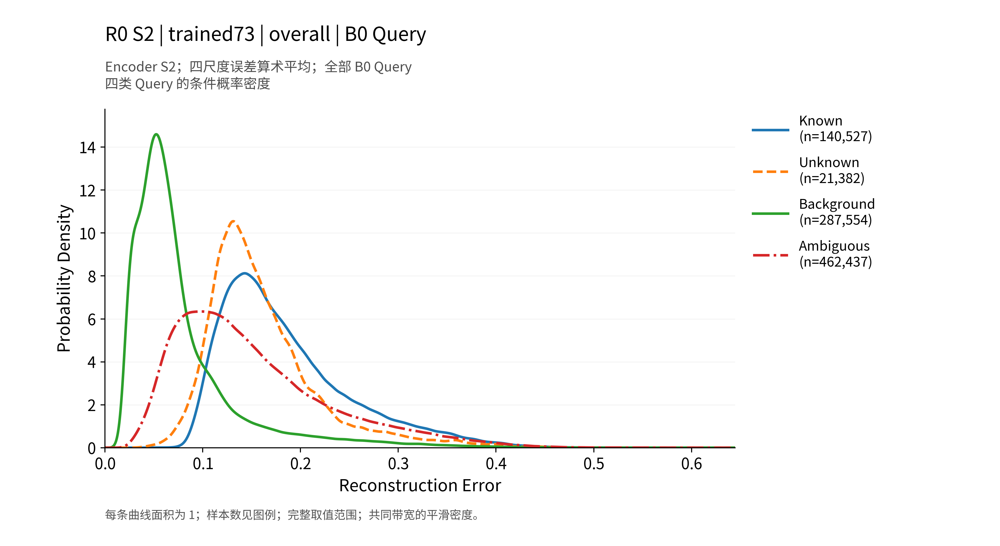
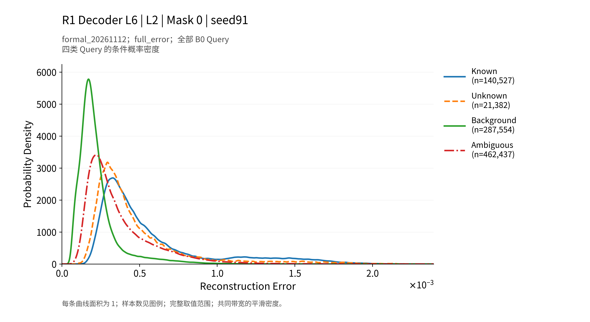
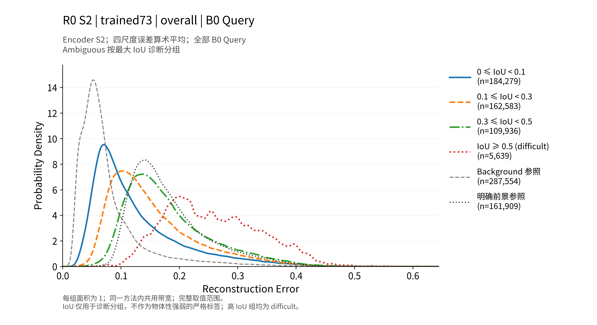
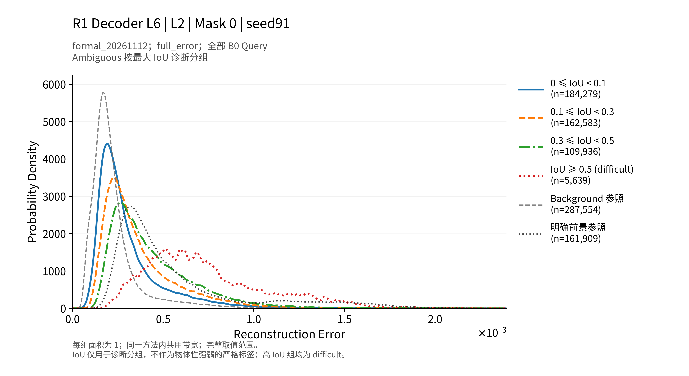
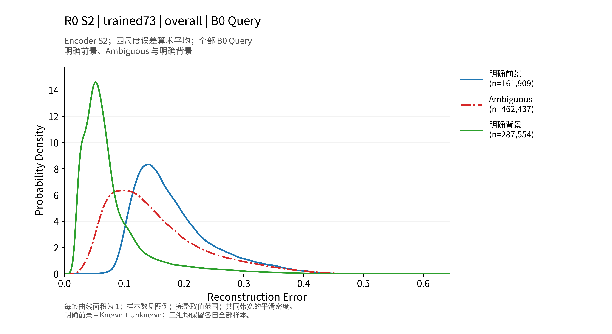
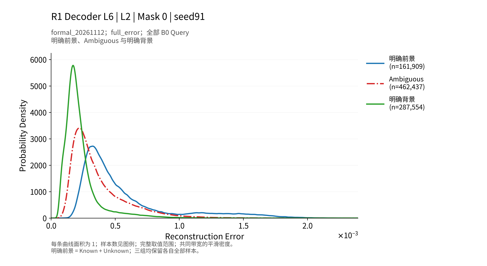
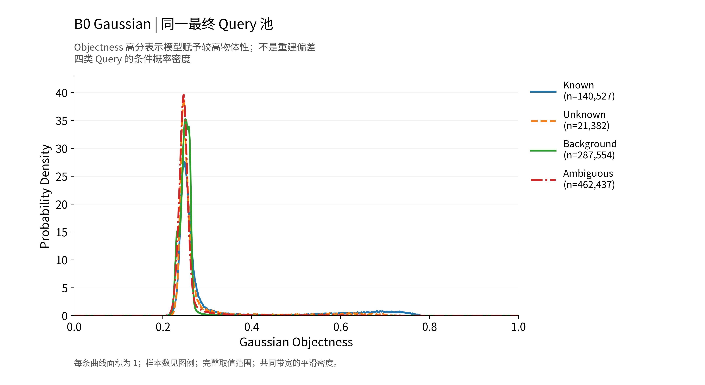
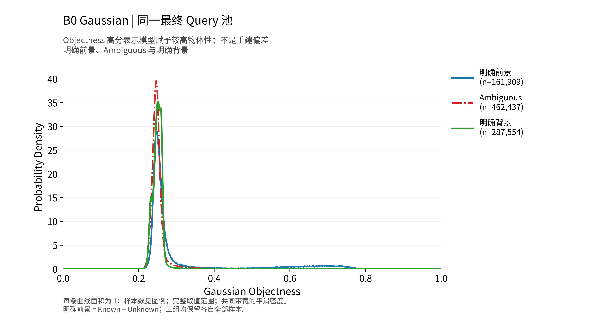

# Ambiguous Query 重建误差补充分析报告

日期：2026-11-16（Asia/Shanghai）。按用户指定名称与目录保存，本轮属于已有实验的补充分析，不新增训练轮次。

## 1. 分析目的与主要结论

**研究问题：DETR 中的重建误差能否区分前景与背景；对部分包含物体信息的 Ambiguous Query，是否也能体现一定的物体性差异。**

当前固定评估池支持以下分布现象：R0 S2 与 R1 L6 的 Background 主体集中在相对低误差区域，Known / Unknown 的中心与四分位区间向右偏移；Ambiguous 的总体中位数位于明确背景与明确前景之间。进一步按最大 IoU 分组，Ambiguous 的均值、中位数、P25 和 P75 在两种方法中均按组别递增，提示重建误差对部分不确定候选具有潜在物体性诊断价值。

这里的“位于之间”指总体位置，不代表三组完全分离。最低 IoU 子组仍高于背景中心；最高 IoU 子组全部是 difficult，且中心超过合并前景，不能将其解读为单一的 IoU 因果效应。本轮不计算或主张 AUROC、Recall@K、Unknown 候选筛选收益，也未检验最终检测性能。

## 2. 数据来源、配置与恢复过程

### 2.1 分析配置

| 项目 | 本轮实际使用配置 |
| --- | --- |
| B0 | 已完成 task1 epoch40，`checkpoint0040.pth`；本轮不加载模型权重 |
| 数据 | `/root/autodl-tmp/datasets/OWOD_B0`，`owod_all_task_test`，去重后 9,119 张图 |
| 候选池 | 每图全部 100 个 B0 最终 Query，共 911,900；不按 selected 过滤，不使用 GT-reference 候选 |
| R0 | `controls_round2` 第二轮正式结果，Encoder S2、trained AE seed73、overall（四尺度原始算术平均） |
| R1 | `formal_20261112/l2_L6_mask0`，Decoder L6、L2 归一化、Mask 0、seed91，仅使用 `full_error` |
| Gaussian | R0 第二轮保存的同一前向 B0 Gaussian 分数；与 R1 逐项完全相同 |

R0 的误差是空间 Encoder 误差图在 Query 框内聚合后四尺度平均；R1 的误差是 L2 Query 向量的全通道均方重建误差。两者量纲和数值范围不同，不能用绝对误差大小比较方法优劣。

### 2.2 实际读取的主要原始文件

1. `/root/autodl-tmp/experiments/R0/controls_round2/analysis/scores.npy`：唯一的 R0 绘图误差来源，切片 `[Query行, S2索引1, trained73索引0, overall索引4]`。
2. `/root/autodl-tmp/experiments/R0/controls_round2/prepared/metadata.csv.gz`：Query 键、裁剪框和正式 `disjoint_gt` 标签；用 `source=query` 选择全部 Query。
3. `/root/autodl-tmp/experiments/R0/controls_round2/analysis/common_valid.npy`：核验全部 Query 有效；`query_scores.npy`：Gaussian 基线。
4. `/root/autodl-tmp/experiments/R0/paired_evaluation/complete.json` 所列的 **285 个 `chunks/*/attempt_*/regions.csv.gz`**：第二轮元数据遗漏 `max_iou_gt`，因此只从这些原候选缓存恢复最大 IoU、键与分组；**未使用其中第一轮重建误差**。
5. `/root/autodl-tmp/experiments/R1/formal_20261112/l2_L6_mask0/evaluation/queries.csv.gz`：`full_error`、`max_iou_gt`、`matched_gt_index`、标签和 Gaussian。
6. R1 对应 `evaluation/summary.json`、`configs/l2_L6_mask0.json`，R0 的第二轮协议/完成清单及 `/root/autodl-tmp/experiments/R0/analysis/grouping_audit.json`：核验配置、轴索引和原始计数。
7. `/root/autodl-tmp/experiments/R1/formal_20261112/evaluation_cache/{image_id}.npz`：只读取已有层号、图像尺寸和框字段，逐项验证 L6 裁剪框与 R0 Query 身份一致；未读取特征进行推理。
8. `/root/autodl-tmp/datasets/OWOD_B0/Annotations/{image_id}.xml`：核查高 IoU Ambiguous 的匹配 GT 是否 difficult。

全部主要标量文件与几何恢复缓存的绝对路径、角色及 SHA256 保存在 [source_manifest.json](source_manifest.json)；全部访问过的 R1 几何缓存和 XML 路径保存在 [geometry_cache_paths.json](geometry_cache_paths.json)。未重训 AE/B0，未做前向推理，未改动原实验文件，未提交 Git。所有新增产物都在本目录，没有进行 Obsidian 写回。

### 2.3 标签规则与一致性

Background 沿用正式的 `disjoint_gt` 规则：有效框与所有已提供 GT 无正面积交集。Known / Unknown 需要最大 IoU≥0.5 且最大匹配 GT 非 difficult；其余有交集的有效候选为 Ambiguous。故 IoU<0.1 但相交的候选仍是 Ambiguous，不能仅凭低 IoU 把它改标背景。

| 组别 | R0 第二轮 | R1 正式 | 与原统计一致 |
| --- | --- | --- | --- |
| known | 140,527 | 140,527 | 是 |
| unknown | 21,382 | 21,382 | 是 |
| background | 287,554 | 287,554 | 是 |
| ambiguous | 462,437 | 462,437 | 是 |
| invalid | 0 | 0 | 是 |

每种方法四类总数均为 911,900，明确前景为 161,909。原始 R0 分组审计、第二轮候选数、R1 正式 summary 三者吻合。逐 Query 键无重复、框/标签/IoU 完全对齐，误差均有限且非负，无有效性剔除或缺失误差。

## 3. 绘图与统计说明

主图采用白底、360 dpi PNG、中文 Noto Sans CJK SC 字体和外置图例，全部由 Matplotlib 绘制，不使用 seaborn。每张图独立保存，配置、样本数、横纵轴都在图中标明。

密度曲线是**全样本直方图分箱后的 Gaussian 平滑（近似 KDE）**，使用 4,096 个等宽箱；同一方法所有组共用由其完整 Query 池确定的稳健 Silverman 带宽。误差在零端作反射边界修正，Gaussian 在零、一两端反射。横轴覆盖完整取值范围，不截尾、不抽样、不按分数筛选；每组曲线面积为 1。峰高表示该组分布集中程度，不表示该类总体数量。CDF 使用全部样本的精确经验累积比例，不平滑，供核验位置和长尾。

辅助统计为完整评估池的描述，不把同图 100 个 Query 当作独立重复试验；每种指定配置仅一个训练种子。本轮不作显著性或泛化置信区间结论。统计与带宽细节见 [stats-appendix.md](stats-appendix.md)。

## 4. 图像说明与主要现象

### 4.1 分析 A：R0 S2 四类误差分布

图注：R0 第二轮、Encoder S2、trained73、overall、全部 B0 Query；四类分别按组归一化。

| 组别 | Query 数 | 均值 | 中位数 | P25 | P75 |
| --- | --- | --- | --- | --- | --- |
| Known | 140,527 | 0.185481 | 0.169038 | 0.136489 | 0.218411 |
| Unknown | 21,382 | 0.161101 | 0.147790 | 0.123217 | 0.183825 |
| Background | 287,554 | 0.078266 | 0.061067 | 0.043826 | 0.089385 |
| Ambiguous | 462,437 | 0.150645 | 0.132249 | 0.091730 | 0.190585 |
| Foreground | 161,909 | 0.182262 | 0.165788 | 0.134215 | 0.213929 |

Background 在低误差区域形成较窄主峰，中间 50% 范围为 [0.043826, 0.089385]。Known / Unknown 的中位数分别为 0.169038、0.147790，均向右偏移；两者 P25 均超过 Background P75。Ambiguous 更宽，中位数 0.132249，高于背景而低于两类明确前景，其 P25=0.091730 略高于背景 P75。

这支持当前候选池中的组间分布差异，同时 Background 仍有高误差长尾，Ambiguous 与 Known/Unknown 存在大范围重叠，不能将误差解释为无误的物体判别器。

### 4.2 分析 B：R1 Decoder L6 四类误差分布

图注：R1 `formal_20261112`、Decoder L6、L2、Mask 0、seed91、`full_error`，全部 B0 Query。图横轴用科学计数法，以下表格误差统一以 ×10⁻³ 展示，CSV 保留原始数值。

| 组别 | Query 数 | 均值 | 中位数 | P25 | P75 |
| --- | --- | --- | --- | --- | --- |
| Known | 140,527 | 0.571748 | 0.433646 | 0.326393 | 0.648780 |
| Unknown | 21,382 | 0.475684 | 0.374770 | 0.287440 | 0.539644 |
| Background | 287,554 | 0.226678 | 0.191227 | 0.147333 | 0.253456 |
| Ambiguous | 462,437 | 0.363538 | 0.295713 | 0.215049 | 0.446506 |
| Foreground | 161,909 | 0.559062 | 0.425124 | 0.320664 | 0.632592 |

Background 主峰位于较低误差处，中位数为 0.191227×10⁻³；Known / Unknown 的中位数分别为 0.433646×10⁻³、0.374770×10⁻³，且两者 P25 均高于背景 P75。Ambiguous 的中位数为 0.295713×10⁻³，处于背景和前景之间，但其 P25 已进入背景的四分位范围，显示低误差部分与背景的明显重叠。

因此，R1 同样支持背景主体偏低、明确前景偏高的分布现象；不能把总体中位数居中扩大为整个 Ambiguous 与两侧完全分离。

### 4.3 分析 C：Ambiguous 内部按最大 IoU 分组

图注：两图均只细分 Ambiguous，区间左闭右开，最后一组包含 0.5；灰色虚线和深色点线分别为背景、明确前景参照。IoU 只作为诊断分组，不是严格物体性标签。

| Ambiguous 最大 IoU 组 | Query 数 | 占 Ambiguous | R0 中位数 [P25, P75] | R1 中位数 [P25, P75]（×10⁻³） |
| --- | --- | --- | --- | --- |
| [0, 0.1) | 184,279 | 39.85% | 0.101799 [0.071293, 0.158220] | 0.247547 [0.186593, 0.355607] |
| [0.1, 0.3) | 162,583 | 35.16% | 0.134656 [0.099314, 0.189785] | 0.303243 [0.224257, 0.445288] |
| [0.3, 0.5) | 109,936 | 23.77% | 0.164367 [0.128396, 0.219058] | 0.373492 [0.270607, 0.547540] |
| [0.5, 1] (difficult) | 5,639 | 1.22% | 0.247659 [0.194056, 0.314155] | 0.665328 [0.492854, 0.909009] |

四组总数 184,279+162,583+109,936+5,639=462,437，完整覆盖 Ambiguous，无重复或遗漏。最高组占 1.22%，来自 1,159 张图；逐项查原 XML 与正式分组代码，均是最大匹配 GT 的 `difficult=1`，没有发现另一个 ignore 原因分支。

R0 的子组中位数依次为 **0.101799 → 0.134656 → 0.164367 → 0.247659**，R1 依次为 **0.247547 → 0.303243 → 0.373492 → 0.665328（×10⁻³）**。两种方法的均值、P25/P75 也都依次增加，说明趋势不只体现在单个主峰。

最低 IoU 组在这些子组中更靠近 Background，但仍高于 Background 中位数，并非纯背景。R0 的 [0.3,0.5) 子组中位数 0.164367 已接近合并前景 0.165788；R1 对应子组中位数 0.373492×10⁻³ 接近 Unknown 0.374770×10⁻³，仍低于合并前景 0.425246×10⁻³。最高 difficult 组明显向高误差移动，甚至超过明确前景中心，这既可能与物体相关信息有关，也可能受难例属性、类别和框几何影响。

这些结果支持“Ambiguous 并非同质样本，重建误差随重叠诊断组呈现系统变化”的描述。它们不证明单个 Query 的误差与 IoU 严格单调，也不证明变化只由物体性引起。

### 4.4 分析 D：明确前景、Ambiguous、明确背景三组

图注：明确前景=Known+Unknown，各图保留三组全部样本。合并前景按实际 Query 等权，不对 Known/Unknown 再作等权平均；其中 Known 占多数。

R0 三组中位数为 **Background 0.061067 < Ambiguous 0.132249 < Foreground 0.165788**。Ambiguous 的中位数位置在两者之间且更靠前景侧。R1 为 **0.191227 < 0.295713 < 0.425246（×10⁻³）**，Ambiguous 的中位数位置略靠背景侧，曲线仍向高误差延伸。这里“更靠近”仅描述中位数位置，不声称完整概率分布距离的结论。

以合并前景 P25 作为相对低值参照，R0 有 **88.50%** 的 Background 低于 0.134215，R1 有 **86.61%** 的 Background 低于 0.000320664。因此“背景主要集中在低误差区域”得到支持，但仍分别有约 11.50%、13.39% 的背景进入该参照以上的尾部。该参照仅用于解释分布，没有用于候选筛选，也不是验证后的检测阈值。

### 4.5 分析 E：Gaussian 辅助基线

图注：Gaussian 的高分方向是模型赋予的物体性较高；重建误差高值表示重建偏差较大，二者不是相同的数值语义。本基线只提供视觉参照。

四类 Gaussian 的主体都集中在约 0.25 附近，重叠较强；Known 有较长高分尾。Known、Unknown、Background、Ambiguous 的中位数分别为 0.255341、0.250515、0.250694、0.247391；Ambiguous 中位数略低于背景，没有呈现简单的“位于两者之间”。Known 均值高于其中位数，提醒不能只凭均值判断主体位置。本图不构成重建误差优于所有物体性建模的证据。

### 4.6 CDF 补充核验

- [R0 四类 CDF](R0_S2_四类CDF.png)
- [R1 四类 CDF](R1_L6_四类CDF.png)
- [R0 Ambiguous IoU 分组 CDF](R0_S2_Ambiguous按IoU分组CDF.png)
- [R1 Ambiguous IoU 分组 CDF](R1_L6_Ambiguous按IoU分组CDF.png)

CDF 显示大部分质量的相对位置与上述分位数一致，同时保留全部尾部。不据此宣称所有横轴位置的严格随机占优；主结论仍是中心与四分位范围的偏移。

## 5. 阶段结论与对当前研究问题的意义

当前数据支持在所指定的 DETR/B0 Query 池中，R0 S2 与 R1 L6 重建误差在明确前景与明确背景之间存在可解释的分布差异：Background 主体偏低，Known / Unknown 主体偏高。

此前评价中排除的 Ambiguous 不是单一噪声集合。其整体中心介于两侧，内部按最大 IoU 分组后的误差中心和四分位范围有序提高，提示重建误差对部分含有物体相关信息的不确定候选也具有潜在诊断价值。低 IoU 部分更偏背景一侧，高重叠部分更偏前景一侧，但仍有交叠、长尾与 difficult 效应。

这些结论属于**固定模型、固定评估集、指定单种子下的离线分布分析**。它们加强了继续研究重建误差与物体相关信息关系的依据，尚未证明可以提升 Unknown Discovery、改善 OWOBJ 或提高最终检测性能。

## 6. 局限与不支持的更强结论

- Query 在图像内及同一 GT 周围相关，911,900 不是独立试验次数。R0 seed73 与 R1 seed91 也不能替代各方法的多种子稳健性验证。
- 这里的背景是相对已有 80 类 GT 标注的几何背景，可能含未标注物体；IoU 也不是完整物体性真值。
- 框尺寸、宽高比、类别、纹理和难度未在本轮分布图中匹配控制。特别是高 IoU 组全部 difficult，不能把其较高误差全归因于更强物体性。
- 曲线平滑带宽会影响局部峰形；结论同时由未平滑的分位数、质量占比与 CDF 支撑，不依赖微小波动。
- Ambiguous 的总体中间位置不代表其每个子组都居中；最高 difficult 组已超过明确前景中心。
- 没有训练误差融合、筛选阈值或检测器更新，没有最终检测指标对照。

## 7. 产物、复现与后续行动

保存目录：`/root/autodl-tmp/experiments/R0_R1_ambiguous_analysis`。

| 文件 | 用途 |
| --- | --- |
| `summary_statistics.csv` | R0/R1/Gaussian 各四类及合并前景，共 15 行统计 |
| `ambiguous_iou_group_stats.csv` | R0/R1 各 4 个 Ambiguous IoU 子组，共 8 行 |
| `distribution_mass_diagnostics.csv` | 背景/前景分位数处的质量比例，用于说明相对低值集中程度 |
| `median_shift_diagnostics.csv` | 相对背景的中位数差及背景 IQR 归一化描述 |
| `paired_query_data.npz` | 已对齐的最小复现输入，组码 0=Known、1=Unknown、2=Background、3=Ambiguous；保留 image_id/query_id、IoU、两种误差、Gaussian |
| `density_curve_data.npz`、`plot_metadata.json` | 实际密度曲线、带宽、归一化检查、字体和图目录 |
| `source_manifest.json`、`geometry_cache_paths.json` | 原始文件路径、校验与字段恢复来源 |
| `analysis-report.md`、`stats-appendix.md`、`figure-catalog.md` | 分析审计、统计方法和逐图解读 |
| `prepare_analysis.py`、`plot_analysis.py`、`write_report.py` | 可复现脚本；日志为 `prepare.log`、`plot.log` |

使用原有 Python 环境 `/root/autodl-tmp/experiments/B0_PROB_OWOBJ/env/bin/python`。在当前目录依次执行上述三个脚本即可复现；脚本没有模型训练或前向路径，Matplotlib 缓存固定在本目录。所需字体已保存在 `fonts/`。本轮要求的 6 张核心图、2 张 Gaussian 图及 4 张 CDF 全部完成，无缺失分组或无法绘制的图。

汇报时优先展示两张四类图和两张 IoU 子组图；需要简化时使用两张三组图。保留“分布差异、潜在诊断价值、尚未验证最终检测性能”的措辞。后续若需要更强物体性解释，应单独设计控制框几何、类别和 difficult 的分析及独立验证；本轮不追加训练或下游实验。
